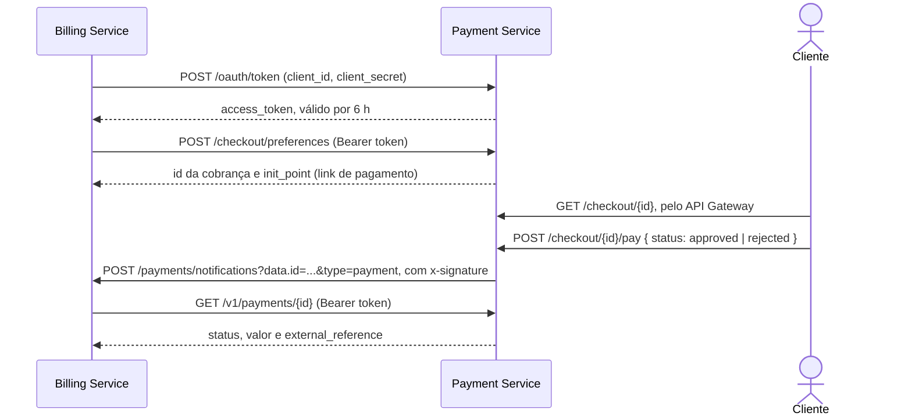

# Payment Service

Simulador do provedor de pagamento da oficina. É o serviço que o Billing Service chama para cobrar o
orçamento aprovado, no lugar que o Mercado Pago ocuparia na arquitetura.

O enunciado pede integração com o Mercado Pago, mas o serviço não tem vínculo com a FIAP e não foi
possível gerar credenciais de teste. A coordenação orientou criar um serviço de pagamento simples, que
imite o fluxo de um provedor e exija um token próprio para ser chamado. É o que este serviço faz: o
Billing troca as credenciais dele por um token, cobra com esse token, o cliente paga num link de checkout,
e o serviço avisa o Billing por um webhook assinado. Nenhum dinheiro de verdade passa por aqui.

A arquitetura do serviço está em [docs/architecture.md](docs/architecture.md). A arquitetura do sistema
inteiro e a decisão sobre o pagamento ficam no repositório do OS Service, em `docs/architecture/`.

## O fluxo



O aviso só diz **qual** pagamento mudou. O Billing lê o resultado com o token dele, e nunca confia no
corpo da notificação.

## Rotas

| Rota | Quem chama | Autenticação | Onde fica |
|---|---|---|---|
| `POST /oauth/token` | Billing | `client_id` e `client_secret` (OAuth 2.0 client credentials) | só dentro do cluster |
| `POST /checkout/preferences` | Billing | `Authorization: Bearer <token>` | só dentro do cluster |
| `GET /v1/payments/{id}` | Billing | `Authorization: Bearer <token>`; só os pagamentos do próprio lojista | só dentro do cluster |
| `GET /checkout/{id}` | Cliente | nenhuma: o id da cobrança funciona como link de pagamento | público, pelo API Gateway |
| `POST /checkout/{id}/pay` | Cliente | nenhuma | público, pelo API Gateway |
| `GET /health` | Kubernetes | nenhuma | dentro do cluster |
| `GET /metrics` | Prometheus | nenhuma | dentro do cluster |

Exemplos:

```bash
# o Billing pede um token
curl -X POST "$PAYMENT/oauth/token" -H 'Content-Type: application/json' \
  -d '{"grant_type":"client_credentials","client_id":"<id>","client_secret":"<segredo>"}'
# { "access_token": "...", "token_type": "Bearer", "expires_in": 21600, "live_mode": false }

# o cliente paga
curl -X POST "$GATEWAY/checkout/<id>/pay" -H 'Content-Type: application/json' -d '{"status":"approved"}'
# { "payment_id": 1234567890, "status": "approved", "merchant_notified": true }
```

### Por que o contrato do Mercado Pago

As rotas, os campos e a assinatura do webhook são os do Mercado Pago, no pedaço que o Billing usa: token
por `client_credentials`, preferência do Checkout Pro, consulta de pagamento e `x-signature` com
HMAC-SHA256 de `id:<data.id>;request-id:<x-request-id>;ts:<ts>;`. Assim o Billing usa o mesmo adaptador que
escreveria para o Mercado Pago, só com outra URL base, e voltar para o provedor real é trocar a URL e as
credenciais.

### Regras

- **Um lojista.** O serviço conhece um único cliente OAuth, o Billing, com as credenciais da configuração.
- **Um pagamento por cobrança.** Uma segunda tentativa responde 409: a primeira recusa já encerra a saga.
- **Aviso com até três tentativas.** Se o Billing não confirmar o recebimento, o pagamento continua
  valendo e a resposta ao cliente traz `merchant_notified: false`.
- **Nunca é produção.** O token sai sempre com `live_mode: false`, que é o que a trava de modo teste do
  Billing confere.

## Limitações

O estado (tokens, cobranças e pagamentos) fica em memória, e por isso o serviço roda com **uma réplica**.
Reiniciar o pod perde as cobranças abertas: o Billing continua com o link, mas o checkout responde 404, e a
ordem precisa de uma nova cobrança. Para um simulador isso basta; um provedor de verdade guardaria tudo
num banco e rodaria com várias réplicas.

## Configuração

| Variável | Para que serve |
|---|---|
| `CLIENT_ID` e `CLIENT_SECRET` | Credenciais do Billing; trocadas por um token em `POST /oauth/token` |
| `WEBHOOK_SECRET` | Segredo compartilhado com o Billing; assina cada aviso de pagamento |
| `CHECKOUT_BASE_URL` | Endereço público do serviço, onde começa o `init_point` de cada cobrança |
| `PORT` | Porta HTTP; `3000` por padrão |
| `LOG_LEVEL` | Nível do log; `info` por padrão |

Sem `CLIENT_ID`, `CLIENT_SECRET`, `WEBHOOK_SECRET` ou `CHECKOUT_BASE_URL`, o serviço não sobe.

## Execução local

Pré-requisito: Node.js 22.

```bash
npm install
CLIENT_ID=billing CLIENT_SECRET=billing-secret WEBHOOK_SECRET=webhook-secret \
CHECKOUT_BASE_URL=http://localhost:3003 PORT=3003 npm run dev
```

No compose de ponta a ponta do OS Service (`e2e/docker-compose.yml`), o serviço sobe junto com os outros
três, e o Billing aponta para ele.

## Kubernetes

Os manifestos ficam em `k8s/`, no namespace `car-repair-shop-payment`, que o `infra-k8s` cria junto com o
cluster.

| Recurso | Nome | Detalhe |
|---|---|---|
| ConfigMap | `payment-config` | Variáveis fixas, versionadas aqui |
| Service | `payment-api` | NLB interno; o API Gateway chega nele para as duas rotas do checkout. O Billing usa o endereço interno `payment-api.car-repair-shop-payment.svc.cluster.local` |
| Deployment | `payment-api` | Uma réplica, estratégia `Recreate`: nunca dois pods com memórias diferentes ao mesmo tempo |

Sem HPA e sem PodDisruptionBudget, pela mesma razão: o estado em memória não se divide entre réplicas.

## CI/CD

O `CI` roda em todo pull request e em todo push na `main`: build, lint, testes, cobertura, validação dos
manifestos com `kubeconform -strict` e a análise no
[SonarQube Cloud](https://sonarcloud.io/project/overview?id=diandria_fiap-tech-challenge-payment), que reprova
o PR quando o quality gate reprova (`sonar.qualitygate.wait`) ou quando o segredo `SONAR_TOKEN` falta. O `CD` dispara quando o `CI` termina verde na `main`:

1. Build da imagem e push no ECR `car-repair-shop-payment`, com a tag do SHA curto do commit.
2. Leitura das credenciais no SSM, em `/car-repair-shop/payment/client-id`, `client-secret` e
   `webhook-secret`, criados pelo Terraform do `infra-k8s`. O CD do Billing lê os mesmos parâmetros, e por
   isso os dois lados sempre têm os mesmos valores. Também lê o endereço do API Gateway, que vira o
   `CHECKOUT_BASE_URL`.
3. ConfigMap `payment-runtime`, Secret `payment-secret` e os manifestos de `k8s/`.
4. Troca da imagem e espera do rollout; se falhar, o CD volta para a revisão anterior e termina com erro.
5. Verificação de `/health` dentro do pod.

O ambiente roda no AWS Academy e só existe durante uma sessão do lab. Com ele desligado, o CD de um merge
termina vermelho sem criar nada: indica ambiente desligado, não código quebrado. As restrições da conta e como
reimplantar estão na seção [Limitação do AWS Academy](https://github.com/diandria/fiap-tech-challenge#limitação-do-aws-academy)
do README do OS Service.

## Testes

```bash
npm test                # unitários e de integração
npm run test:coverage   # com relatório de cobertura; o mínimo é 80%
```

Os testes de integração seguem o padrão GIVEN / WHEN / THEN e percorrem o fluxo inteiro por HTTP: token,
cobrança, pagamento, aviso recebido por um servidor HTTP de verdade e leitura do pagamento. A assinatura do
aviso é conferida com a mesma conta que o Billing faz, para provar que o Billing aceita os avisos daqui.

## Repositórios

| Repositório | Papel |
|---|---|
| [fiap-tech-challenge](https://github.com/diandria/fiap-tech-challenge) | OS Service e documentação central |
| [fiap-tech-challenge-billing](https://github.com/diandria/fiap-tech-challenge-billing) | Billing Service, o lojista deste provedor |
| [fiap-tech-challenge-execution](https://github.com/diandria/fiap-tech-challenge-execution) | Execution Service |
| fiap-tech-challenge-payment | Este serviço |
| [fiap-tech-challenge-infra-k8s](https://github.com/diandria/fiap-tech-challenge-infra-k8s) | Cluster, gateway, filas e observabilidade |
| [fiap-tech-challenge-infra-db](https://github.com/diandria/fiap-tech-challenge-infra-db) | Banco do OS Service |
| [fiap-tech-challenge-lambda](https://github.com/diandria/fiap-tech-challenge-lambda) | Funções de autenticação e notificação |
