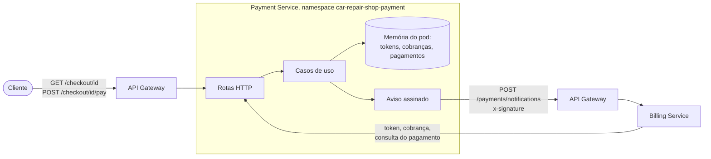

# Arquitetura do Payment Service

O Payment Service faz o papel de um provedor de pagamento externo. Ele não participa da saga: quem
participa é o Billing, que cobra aqui o orçamento aprovado e responde à saga quando o pagamento se
resolve. Para o resto do sistema, este serviço está do lado de fora, como o Mercado Pago estaria.

## Visão do serviço

O Billing fala com este serviço pelo endereço interno do cluster. O aviso de pagamento volta pelo API
Gateway, na rota pública que o Billing já expõe para o Mercado Pago.

## Camadas

O código segue a Clean Architecture dos outros serviços, com as dependências apontando para dentro.

| Camada | Pasta | O que tem |
|---|---|---|
| Entidades | `src/entities/` | `Preference` (cobrança: itens, total em centavos, validação) e `Payment` (status e detalhe no formato do Mercado Pago) |
| Casos de uso | `src/use-cases/` | `IssueAccessTokenUseCase`, `CreatePreferenceUseCase`, `GetCheckoutUseCase`, `PayCheckoutUseCase` e `GetPaymentUseCase`, com as portas `IAccessTokenStore`, `IPreferenceRepository`, `IPaymentRepository` e `IMerchantNotifier` |
| Adaptadores | `src/adapters/` | Os três repositórios em memória, o `SignedWebhookNotifier` e o `ProviderController`, que traduz o contrato HTTP em snake_case para os nomes do domínio |
| Frameworks | `src/frameworks/` | Express, configuração, logger, métricas e a composição (`compose.ts`), o único lugar que conhece as classes concretas |

## Dados

Tudo fica em memória, num `Map` por tipo:

| Dado | Chave | Detalhe |
|---|---|---|
| Token de acesso | 64 caracteres hex aleatórios | Lojista dono e validade de 6 horas; vencido, deixa de existir |
| Cobrança | UUID | Itens, total, `external_reference` (o id da OS), `notification_url` e o lojista que a criou |
| Pagamento | Número aleatório de 10 dígitos | Cobrança, status, detalhe, valor e `external_reference`; aleatório para um reinício não repetir id que o Billing já guardou |

Por isso o Deployment tem uma réplica e usa `Recreate`. O custo é perder as cobranças abertas num
reinício, que o README registra como limitação.

## Segurança

- O token é opaco e só este serviço o valida; o segredo do lojista só aparece na troca por token.
- Id e segredo do lojista são comparados em tempo constante, e a resposta não diz qual dos dois errou.
- Um lojista não enxerga pagamento de outro: a consulta responde 404, como se ele não existisse.
- As rotas do lojista ficam só dentro do cluster. No API Gateway entram apenas as duas rotas do checkout.
- O log mascara `client_secret`, `access_token`, `Authorization` e `x-signature`.
